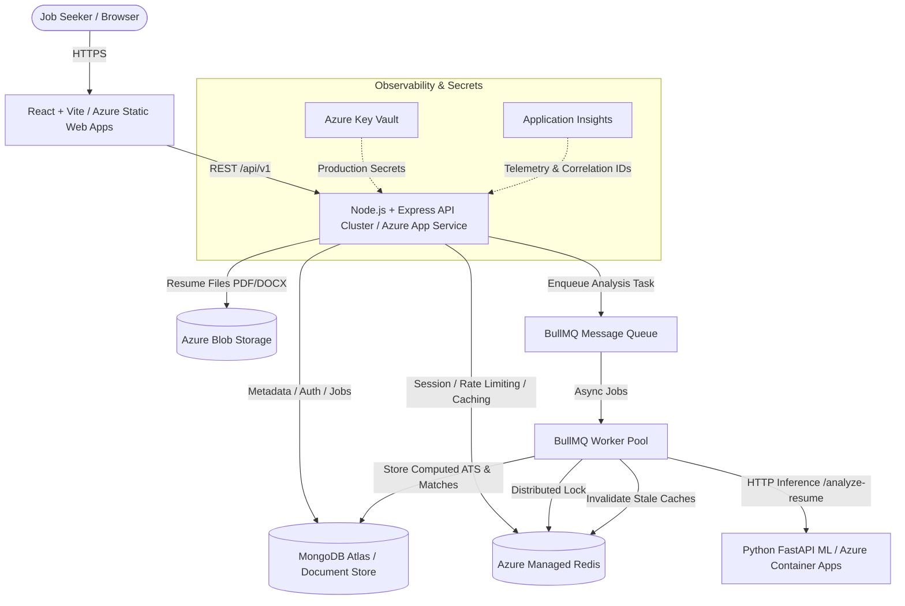

# 🚀 AI Resume Analyzer & Job Matcher
**Enterprise Full-Stack Cloud & ML Platform**

An intelligent, production-grade AI/ML web application designed for students and job seekers. Users upload PDF/DOCX resumes, which are processed asynchronously through a distributed Natural Language Processing (NLP) pipeline to extract technical competencies, calculate ATS compatibility scores, pinpoint skill gaps with actionable learning pathways, and match profiles against tech job listings using TF-IDF and Cosine Similarity.

---

## 📑 Table of Contents
1. [System Architecture](#-system-architecture)
2. [Technology Stack](#-technology-stack)
3. [Key Features](#-key-features)
4. [AI/ML Engine & Math Formulation](#-aiml-engine--math-formulation)
5. [Storage & Cloud Architecture](#-storage--cloud-architecture)
6. [API Specification (v1)](#-api-specification-v1)
7. [Local & Docker Deployment](#-local--docker-deployment)
8. [Azure Production Deployment](#-azure-production-deployment)
9. [CI/CD & GitHub Actions](#-cicd--github-actions)
10. [Testing & Load Testing](#-testing--load-testing)
11. [Viva & Architectural Defense](#-viva--architectural-defense)

---

## 🏛️ System Architecture

The platform separates user-facing traffic, stateless API gateways, message queues, and high-compute ML inference:



---

## 💻 Technology Stack

| Layer | Technologies | Key Responsibilities |
|---|---|---|
| **Frontend** | React, Vite, Tailwind CSS, Lucide Icons, Recharts, Axios | Responsive dashboard, ATS score gauges, interactive job search, skill gap visualization. |
| **Backend API** | Node.js, Express.js, Mongoose, Zod, Helmet, Pino | Stateless API gateway, authentication, rate limiting, RBAC, input validation. |
| **Asynchronous Queue** | Redis 7, BullMQ | Decouples heavy NLP processing from Express request-response loop; provides exponential backoff retries. |
| **AI / ML Service** | Python 3.11, FastAPI, spaCy, PyMuPDF, python-docx, scikit-learn | Stateless text extraction, entity recognition, TF-IDF vectorization, Cosine Similarity matching. |
| **Database** | MongoDB Atlas (v7) | Rich document storage for Resumes, Job records, Compound-indexed Job Matches, and Audit Logs. |
| **Cloud Storage** | Local Disk (Dev) / Azure Blob Storage (Prod) | Secure off-database storage for original PDF/DOCX resume files. |
| **Cloud & DevOps** | Docker, Docker Compose, Azure App Service, Azure Container Apps, Azure Key Vault, GitHub Actions | Zero-downtime horizontal container scaling, automated CI/CD pipeline. |

---

## 🎯 Key Features

- **Multi-Format Parsing**: Extracts clean text, sections, and metadata from both `.pdf` (PyMuPDF) and `.docx` (python-docx).
- **Asynchronous 202 Pipeline**: Resume uploads return immediately (`202 Accepted`) with a tracking ID while BullMQ handles ML processing in the background.
- **Intelligent ATS Scoring (0–100)**: Evaluates technical skills (30%), project impact (20%), work history (20%), education (10%), certifications (10%), and keyword completeness (10%).
- **Weighted Job Matching**: Combines TF-IDF textual cosine similarity (40%), direct skill overlap (40%), and experience relevance (20%).
- **Scalable Candidate Pre-filtering**: Filters candidate jobs at the database index layer before performing vector math, enabling sub-second matching across 100,000+ listings.
- **Skill Gap & Learning Pathways**: Pinpoints exact missing competencies and provides step-by-step curriculum paths (e.g. Docker, Kubernetes, AWS, TypeScript).
- **Enterprise Security**: JWT access/refresh token rotation, bcrypt password hashing, Redis-backed rate limiting, and Role-Based Access Control (USER vs ADMIN).
- **Full Observability**: Request correlation via `X-Request-ID`, structured JSON logging with Pino, Azure Application Insights integration, and interactive Swagger UI at `/api/docs`.

---

## 🧮 AI/ML Engine & Math Formulation

### 1. TF-IDF & Textual Cosine Similarity (40% Weight)
Every resume and job description is normalized, lemmatized, and converted into term frequency-inverse document frequency vectors:

$$\text{TF-IDF}(t, d, D) = \text{TF}(t, d) \times \log\left(\frac{1 + |D|}{1 + |\{d \in D : t \in d\}|}\right) + 1$$

The textual similarity is computed using the cosine of the angle between vectors:

$$\text{Cosine Similarity}(\vec{u}, \vec{v}) = \frac{\vec{u} \cdot \vec{v}}{\|\vec{u}\|_2 \|\vec{v}\|_2} = \frac{\sum_{i=1}^{n} u_i v_i}{\sqrt{\sum_{i=1}^{n} u_i^2} \sqrt{\sum_{i=1}^{n} v_i^2}}$$

### 2. Skill Match Score (40% Weight)
Evaluates overlap against required skills (75% sub-weight) and preferred skills (25% sub-weight):

$$\text{SkillScore} = 0.75 \times \frac{|\text{Matched Required}|}{|\text{Total Required}|} + 0.25 \times \frac{|\text{Matched Preferred}|}{\max(1, |\text{Total Preferred}|)}$$

### 3. Experience Relevance (20% Weight)
Calculates whether the candidate's years of experience and domain tenure align with the job's minimum and maximum bands:

$$\text{Total Match} = 0.40 \times \text{TextSimilarity} + 0.40 \times \text{SkillScore} + 0.20 \times \text{ExperienceScore}$$

### 4. Machine Learning Pipeline & Kaggle Datasets

The production matching pipeline is powered by two real Kaggle datasets:
1. **Kaggle Resume Dataset** (`ml-service/data/raw/resumes.csv` from Gaurav Dutta): 962 raw CVs across 25 domain categories, preprocessed and deduplicated to 166 rich profiles.
2. **Kaggle Job Description Dataset** (`ml-service/data/raw/jobs.csv` from Indeed Job Listings): 100 listings preprocessed and normalized to 93 structured job specs with required skills and experience ranges.

#### Dataset Preprocessing, Training & Evaluation Commands

Run all ML pipeline steps locally via the Python virtual environment:

```bash
# 1. Inspect, clean, normalize text, extract skills, and produce processed CSVs:
python ml-service/training/preprocess_data.py

# 2. Fit TF-IDF Vectorizer on combined corpus and train Logistic Regression category classifier:
python ml-service/training/train_model.py

# 3. Evaluate models (Accuracy, Precision, Recall, F1, Confusion Matrix, and Matching benchmarks):
python ml-service/training/evaluate_model.py

# 4. Ingest normalized Kaggle jobs into the production MongoDB database:
python scripts/import_jobs.py

# 5. Run FastAPI ML Service locally in development mode:
cd ml-service
uvicorn main:app --host 0.0.0.0 --port 8000 --reload
```

#### ML Service API Endpoints
- `POST /analyze-resume` — Parses PDF/DOCX or raw text, extracts contact info, skills, education, experience, ATS score, strengths, weaknesses, and recommendations.
- `POST /match-jobs` — Calculates multi-factor match percentages and skill gap roadmaps across candidate jobs.
- `GET /health` — Service health probe.
- `GET /model-info` — Exposes active algorithm version (`tfidf-v1`), corpus sizes, and model metrics.
- `POST /reload-model` — Hot-reloads updated serialized models from disk without restarting containers.

---

## ☁️ Storage & Cloud Architecture

### Storage Service Abstraction
File storage uses a polymorphic provider design pattern ([`src/services/storage.service.js`](file:///Users/adityagupta/Desktop/projects/ai%20resume%20job%20matcher/backend/src/services/storage.service.js)):
- **`LocalStorageProvider`**: Writes to Docker volume (`uploads/`) for local development.
- **`AzureBlobStorageProvider`**: Writes to Azure Blob Storage container (`resumes`) using `@azure/storage-blob` when `AZURE_STORAGE_CONNECTION_STRING` is configured.

Resumes are **never stored as binary blobs inside MongoDB**; only the storage metadata (`storageKey`, `storageProvider`, `fileSize`, `fileType`) is stored in the database document.

---

## 📡 API Specification (v1)

Interactive Swagger UI documentation is available at: **`http://localhost:5001/api/docs`**

### Authentication
- `POST /api/v1/auth/register` — Create user account with name, email, password.
- `POST /api/v1/auth/login` — Sign in; returns short-lived JWT access token and refresh token.
- `POST /api/v1/auth/refresh` — Rotate refresh token and issue new token pair.
- `POST /api/v1/auth/logout` — Revoke active refresh token.
- `GET /api/v1/auth/me` — Retrieve authenticated user profile.

### Resumes & Analysis
- `POST /api/v1/resumes/upload` — Upload PDF/DOCX (Max 10MB); returns `202 Accepted` with `resumeId`.
- `GET /api/v1/resumes` — Paginated history of user resumes.
- `GET /api/v1/resumes/:id` — Resume metadata and extracted text.
- `GET /api/v1/resumes/:id/status` — Polling status (`QUEUED`, `PROCESSING`, `COMPLETED`, `FAILED`).
- `GET /api/v1/resumes/:id/analysis` — Full cached ATS score, strengths, weaknesses, and recommendations.
- `POST /api/v1/resumes/:id/reanalyze` — Re-queue resume analysis under an incremented version.
- `DELETE /api/v1/resumes/:id` — Delete resume, associated matches, and remote storage file.

### Jobs & Matching
- `GET /api/v1/jobs` — Paginated job listings with keyword, location, and skill filters.
- `GET /api/v1/jobs/:id` — Detailed job specification.
- `GET /api/v1/jobs/recommended` — AI-ranked matching jobs for user's resume with match percentage breakdowns.
- `POST /api/v1/jobs/:id/save` — Bookmark a job listing (idempotent).
- `DELETE /api/v1/jobs/:id/save` — Remove job from bookmarks.
- `GET /api/v1/jobs/saved` — List user's saved jobs.

### Admin Controls (Role: `ADMIN`)
- `POST /api/v1/jobs` — Create new job listing.
- `PATCH /api/v1/jobs/:id` — Update job details.
- `DELETE /api/v1/jobs/:id` — Deactivate job listing.

### Health Probes
- `GET /health` — Full dependency probe (MongoDB, Redis, ML Service).
- `GET /live` — Process liveness verification.
- `GET /ready` — Traffic readiness verification.

---

## 🐳 Local & Docker Deployment

### 1. Quick Start with Docker Compose
Clone the repository and run all 6 containers with one command:

```bash
docker compose up -d --build
```

### 2. Service Endpoints
| Service | Local URL | Port |
|---|---|---|
| **Frontend Web App** | http://localhost:5173 (Dev) or http://localhost:3000 (Prod Nginx) | 5173 / 3000 |
| **Backend REST API** | http://localhost:5001/api/v1 | 5001 |
| **Swagger API Docs** | http://localhost:5001/api/docs | 5001 |
| **FastAPI ML Service** | http://localhost:8000/docs | 8000 |
| **MongoDB** | mongodb://localhost:27017/ai_resume_job_matcher | 27017 |
| **Redis** | redis://localhost:6379 | 6379 |

### 3. Horizontal Scaling
Test horizontal worker and backend scaling locally:
```bash
docker compose up --scale backend=3 --scale worker=3 -d
```

---

## ☁️ Azure Production Deployment

### Production Architecture
1. **Frontend**: Deployed to **Azure Static Web Apps** with global edge CDN distribution.
2. **Backend**: Deployed to **Azure App Service (Linux Containers)** with autoscale rules (CPU > 70%).
3. **ML Service & Worker Pool**: Deployed to **Azure Container Apps** with KEDA queue-based scaling (scales workers based on BullMQ Redis queue depth).
4. **Data & Cache**: **MongoDB Atlas** M10+ cluster and **Azure Managed Redis** (Enterprise).
5. **Storage & Secrets**: **Azure Blob Storage** for resumes; **Azure Key Vault** with Managed Identity for zero secret exposure.

---

## 🔄 CI/CD & GitHub Actions

Automated workflows are located in [`.github/workflows/`](file:///Users/adityagupta/Desktop/projects/ai%20resume%20job%20matcher/.github/workflows/):
- **`ci.yml`**: Runs on every push/PR to validate Node.js tests, frontend Vite production bundle build, and Python syntax.
- **`deploy-azure.yml`**: Automatically builds multi-stage Docker images, pushes to **Azure Container Registry (ACR)**, and triggers rolling deployments to Azure Container Apps and Azure App Service.

---

## 🧪 Testing & Load Testing

### Unit & Integration Tests
Run the comprehensive test suite in the backend:
```bash
cd backend
npm test
```

### Concurrency & Load Testing (k6)
Run simulated traffic load tests:
```bash
k6 run load-tests/load-test.js
```
**Engineering Targets**:
- 95% of requests completed under 400ms (`p(95) < 400ms`).
- Error rate under 1% (`rate < 0.01`).

---

## 🎓 Viva & Architectural Defense (Complete Q&A)

### Q1: Why React?
> **Answer**: React offers a component-driven architecture, virtual DOM reconciliation for instant UI updates, and an extensive ecosystem of rich data visualization libraries (Recharts, Lucide, Tailwind). Its reactive state management enables real-time polling of asynchronous analysis statuses without full-page reloads.

### Q2: Why Node.js & Express?
> **Answer**: Node.js has an asynchronous, non-blocking I/O event loop ideal for high-throughput API gateways and orchestrating I/O-intensive microservices (MongoDB, Redis, Azure Blob Storage). Express provides a lightweight, modular middleware architecture for authentication, rate limiting, request tracing, and error handling with minimal memory footprint.

### Q3: Why Python & FastAPI?
> **Answer**: Python is the premier industry standard for Natural Language Processing and Machine Learning, boasting mature libraries like spaCy, scikit-learn, PyMuPDF, and python-docx. FastAPI was chosen over Flask/Django because it is built on ASGI (Starlette + Pydantic), providing asynchronous concurrency, high throughput, automatic request validation, and self-documenting OpenAPI schemas.

### Q4: Why MongoDB Atlas?
> **Answer**: Resumes and job listings exhibit semi-structured, variable schemas. Candidates have diverse arrays of skills, projects, and work history. MongoDB documents map 1-to-1 with JSON entities without requiring expensive multi-table JOINs across normalized schemas. Compound indexing on `{ requiredSkills: 1, isActive: 1 }` enables sub-second candidate pre-filtering across 100,000+ jobs.

### Q5: Why Redis?
> **Answer**: Redis operates entirely in-memory with sub-millisecond latency. In our architecture, it serves 4 critical functions:
> 1. Cache-aside store for candidate ATS scores, skill gaps, and job listings (`resume:{id}:analysis`).
> 2. High-performance backing engine for BullMQ job queues.
> 3. Sliding-window distributed rate limiting across multiple API instances.
> 4. Distributed locking (`SET NX EX`) to guarantee idempotent, single-worker execution.

### Q6: Why BullMQ?
> **Answer**: BullMQ provides a robust, Redis-backed message broker capable of handling high concurrency with features like deterministic job deduplication (`jobId`), exponential backoff retries, delayed jobs, stalled job detection, and worker concurrency controls without losing tasks during container restarts.

### Q7: Why Docker & Docker Compose?
> **Answer**: Docker guarantees environment parity between local development and cloud production, bundling OS-level dependencies (like Poppler, libmagic, or C++ build tools required by spaCy). Multi-stage builds produce minimal, secure images run by non-root users. Docker Compose orchestrates the full 6-service mesh with automated health checks and network isolation.

### Q8: Why TF-IDF and Cosine Similarity?
> **Answer**: Keyword counting suffers from frequency bias (repeating a keyword artificially inflates scores). TF-IDF penalizes pervasive stop-words while rewarding distinctive technical terms. Cosine Similarity normalizes for document length by evaluating the cosine of the angle between high-dimensional vectors, ensuring concise resumes are treated equitably against verbose resumes.

### Q9: Why NLP (spaCy & PyMuPDF)?
> **Answer**: Resumes do not follow a standardized template. PyMuPDF extracts raw structural text from multi-column PDFs without losing spatial ordering. spaCy performs entity recognition, sentence segmentation, lemmatization, and phrase matching to distinguish skills mentioned in past work experiences from isolated keywords.

### Q10: Why Microsoft Azure?
> **Answer**: Azure offers enterprise-grade compliance, native integration between serverless containers (Azure Container Apps) and managed platforms (Azure App Service, Static Web Apps), centralized zero-trust secrets management (Key Vault), and Application Insights telemetry.

### Q11: Why Azure Blob Storage?
> **Answer**: Storing multi-megabyte binary resume files directly in MongoDB bloats document size, exhausts RAM cache (WiredTiger buffer pool), and breaches BSON 16MB document limits. Blob Storage provides virtually infinite, cost-effective, tiered binary object storage with SAS URL access and encryption at rest.

### Q12: Why Azure Container Apps for ML & Workers?
> **Answer**: ML inference and worker queues experience volatile traffic spikes. Azure Container Apps is built on Kubernetes (AKS) and KEDA, enabling automatic scaling to zero when idle and rapid scale-out to multiple replicas under queue pressure, optimizing cloud expenditure.

### Q13: Why Azure App Service for Backend API?
> **Answer**: App Service offers fully managed Linux container hosting with built-in health monitoring, auto-scaling rules based on HTTP request queues and CPU, custom domain SSL termination, and native zero-downtime deployment slots.

### Q14: Why Azure Static Web Apps for React?
> **Answer**: Single-Page Applications (SPAs) are static assets (HTML/CSS/JS) that do not require server compute. Azure Static Web Apps serves them via a global Content Delivery Network (CDN) with free SSL certificates, automated GitHub Actions deployments, and ultra-fast edge loading times.

### Q15: Why Azure Key Vault?
> **Answer**: Storing API keys, JWT secrets, and database connection strings in environment files or source code poses severe security risks. Key Vault securely stores production secrets and permits access via Azure Managed Identity, ensuring no plain-text credentials exist on the file system or in git commits.

### Q16: Why Application Insights?
> **Answer**: Application Insights delivers unified end-to-end distributed transaction tracing, live metrics, dependency failure tracking (MongoDB, Redis, ML HTTP calls), and exception logging correlated via `X-Request-ID`.

### Q17: How does the resume matching algorithm work?
> **Answer**: 
> 1. Scalable Pre-filtering: MongoDB filters candidate jobs requiring at least one candidate skill.
> 2. Text Normalization: Cleans, lowercases, and lemmatizes resume and job descriptions.
> 3. TF-IDF Cosine Similarity: Evaluates textual similarity of technical experience.
> 4. Direct Skill Matching: Compares candidate skills against required (75%) and preferred (25%) job skills.
> 5. Experience Alignment: Compares career tenure against required years of experience.
> 6. Composite Score: Weighted formula combines Text (40%), Skills (40%), and Experience (20%).

### Q18: How is the ATS Resume Score (0–100) calculated?
> **Answer**:
> - **Skills (30 pts)**: Count and breadth of verified technical competencies.
> - **Projects (20 pts)**: Action-verb density, quantifiable metrics, and architecture descriptions.
> - **Experience (20 pts)**: Professional work history and role responsibilities.
> - **Education (10 pts)**: Degree level, institution, and major fields.
> - **Certifications (10 pts)**: Cloud and industry credentials (AWS, Azure, Docker, etc.).
> - **Completeness & Keywords (10 pts)**: Word count, structural sections, and ATS layout readability.

### Q19: How does Redis improve system performance?
> **Answer**: Redis eliminates redundant computation. Frequently accessed job catalogs, dashboard summaries, and immutable resume analyses are cached with a configurable TTL. Subsequent requests resolve in <5ms without querying MongoDB or triggering ML inference.

### Q20: How does BullMQ improve scalability?
> **Answer**: It separates the fast, synchronous HTTP API (client requests) from slow, compute-heavy ML processing. Even if 1,000 resumes are uploaded simultaneously, the API remains responsive with instant `202 Accepted` receipts, while workers pull jobs from Redis at a controlled concurrency rate without overwhelming the ML cluster.

### Q21: How does horizontal scaling work across multiple instances?
> **Answer**: Both Express backend and Python ML instances are completely stateless:
> - Sessions and JWT verification rely on cryptographic tokens, not in-memory sessions.
> - Storage relies on Azure Blob Storage or shared volumes, not local disks.
> - Queue state lives in Redis.
> - Data lives in MongoDB Atlas.
> Consequently, running `docker compose up --scale backend=3 --scale worker=3` or auto-scaling in Azure works seamlessly without split-brain or state synchronization issues.

### Q22: How does the system prevent duplicate resume processing?
> **Answer**: Through deterministic job IDs (`resume-analysis:{resumeId}:{version}`) in BullMQ, combined with Redis distributed locks (`SET lock:resume:{id} NX EX 600`). If a job with the same ID is already pending or running, BullMQ rejects the duplicate.

### Q23: How does the system handle component failures?
> **Answer**:
> - **ML Service Downtime**: Handled by an automated Circuit Breaker pattern (CLOSED -> OPEN -> HALF-OPEN) preventing cascading thread exhaustion.
> - **Worker Crashes**: BullMQ stalled job detection automatically moves abandoned jobs back to the active queue for another worker to resume.
> - **Database / Cache Disconnects**: Auto-reconnection logic with exponential backoff and graceful shutdown handlers (`SIGTERM`/`SIGINT`) to drain active requests safely.

### Q24: How is tenant data isolation enforced?
> **Answer**: Every protected endpoint validates the JWT token and extracts `req.user.id`. Data access queries strictly enforce compound ownership (`userId: req.user.id`). User A cannot view, reanalyze, or delete resumes, saved jobs, or profiles belonging to User B.

